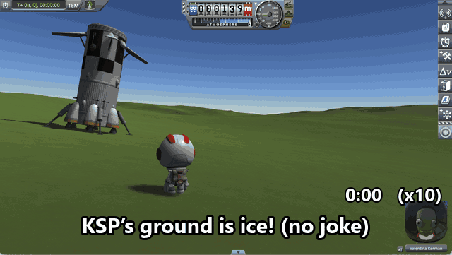
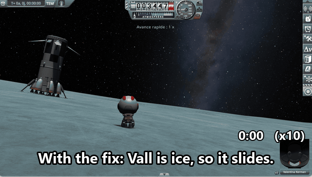

# Terrain Grip Fix

**⚠️ Not finished yet.** This is a new fix, not a finished mod. The code, the grips it gives each terrain and the
conclusions on this page can still change.

Here is what it fixes:

> **In KSP, every terrain is ice.** A rocket standing on its landing legs slides down a gentle grassy slope of Kerbin,
> brakes on. A rover braked on the Mun keeps sliding down a slope a car would park on, and takes ages to stop.



*Stock KSP 1.12.5: a rocket of 12 t on four LT-2 landing legs, brakes on, on a grassy slope of Kerbin; Valentina
stands still. Two minutes, sped up 10 times. Save and protocol: [Checking it](#checking-it).*

The wheel physics of KSP can give each terrain its own grip, but the game never uses it: a landing leg has the grip of
metal on ice wherever it stands. And the grip of tyres drops with gravity twice over (see *The causes*).

**How this was made.** This fix was written with the help of Claude, an AI, then read and checked by a human. I say
so up front because a contribution made with an AI deserves a closer look, and because some will prefer to stop here.
What there is to check is small: two changes to how the game computes the grip of a wheel, described below.

## The causes

**One grip for every terrain.** The tyres of the wheel physics multiply their grip by that of the ground material
they touch, given by a ground material manager. The game installs none: every terrain has a grip of 1, and only the
tyre curve of each part counts. The landing legs have the curve of metal on ice (`frictionAdherent = 0.1`): at rest,
they hold a tenth of their load, about a 6° slope, whatever they stand on.

**A tyre grip that drops with gravity.** In automatic friction, the game scales the tyre curve by `1.6 × g + 0.4`
(`ModuleWheelBase.ApplyGeeBias`): ×2 on Kerbin, ×0.67 on the Mun, ×0.48 on Minmus, ×3.1 on Eve. The weight a tyre
carries already follows gravity: its grip went as the square of gravity.

## What the fix does

- **The grip of the terrain.** Each wheel gets a grip that depends on what it is made of (a tyre, the metal foot of a
  landing leg) and on what it stands on: the body and the biome under it, a building, a part of a vessel. A tyre on
  the soil of Kerbin keeps the grip it has in the game; a landing leg slides on ice, but is held by soil, sand or
  regolith.
- **The same tyre grip on every body.** Automatic friction keeps its value on Kerbin everywhere: nothing changes on
  Kerbin, grip rises on every smaller body, and drops by a third on Eve, the only body above 1 g, where a tyre still
  holds 1.7 times what it holds on Kerbin. The friction slider of the wheels, in manual, works as before.

Each of the two can be turned off in `KSPFixTerrainGrip\PluginData\settings.cfg` (`terrainGrip`,
`kerbinAutoFriction`), read when KSP starts.

## Configuration packs

The fix changes nothing on a body no configuration pack names: install at least one. `KSPFixTerrainGripStock` gives
the terrain of the stock bodies, biome by biome; `KSPFixTerrainGripRSS` that of the bodies of
[Real Solar System](https://github.com/KSP-RO/RealSolarSystem) (it needs ModuleManager, and does nothing without RSS).
Both can stay installed together: with RSS, the stock bodies are gone, and their pack names none of its bodies. The materials and their grips are in
`KSPFixTerrainGrip\TerrainGrip.cfg`; the bodies of a pack in nodes any mod can add to or patch with ModuleManager:

```
TERRAINGRIP_BODY
{
    name = Minmus
    material = snow
    BIOME
    {
        name = Flats
        material = ice
    }
}
```

What is not terrain has a material too: buildings and launch sites are concrete, the parts of a vessel metal (but a
grip pad of Breaking Ground the material picked in its menu), an asteroid rock, a comet ice.

## Checking it

Two saves, in [diag](diag/): the same rocket of 12 t standing on four LT-2 landing legs, brakes on, SAS on, with
Valentina on EVA nearby, the active vessel.

- **[TerrainGripLegsSlope.sfs](diag/TerrainGripLegsSlope.sfs)**: on a grassy slope of Kerbin, Valentina 15 m away.
- **[TerrainGripLegsIce.sfs](diag/TerrainGripLegsIce.sfs)**: on a slope of Vall, which is ice, Valentina 55 m away.

Only the feet of the legs touch the ground: their springs are set a little stiffer than the game's automatic setting
(*Spring/Damper: Manual*, spring 2), so that the engines at the bottom of the rocket stay clear of the ground. Resting
on its engines, the rocket would be held by them, not by its legs.

**By hand.** Copy a save into the folder of a sandbox game, load it (Alt+F9), and watch the rocket from Valentina: she
does not move, the rocket does or not.

**By script.** [run-legs-slope.py](diag/run-legs-slope.py) plays it through
[KSP-Util-MCPServer](https://github.com/lhervier/KSP-Util-MCPServer), with nothing but Python 3. With the save
copied and KSP at its main menu:

```
python run-legs-slope.py --folder <your sandbox game> --trials 2
python run-legs-slope.py --folder <your sandbox game> --save TerrainGripLegsIce --trials 2
```

For each trial it loads the save, makes the rocket the active vessel, and reads where it stands every 10 s for a
minute. What it read, two trials each:

| | Slope under the rocket | Slid in 60 s |
|---|---|---|
| Grass of Kerbin, stock | 9.6° | 9.3 m, 9.6 m |
| Grass of Kerbin, with the fix | 9.6° | 0.02 m, 0.08 m |
| Ice of Vall, with the fix | 9.6° | 8.9 m, 8.9 m |

With the fix, the rocket no longer moves on the grass, and still slides on the ice:



*KSP 1.12.5 with Terrain Grip Fix and its stock pack: the save TerrainGripLegsIce. Two minutes, sped up 10 times.*

## Limits

- **A rover accelerating hard on a very small body lifts its front wheels.** With more grip, its motors can push
  harder than its small weight holds down. The traction control of the wheels limits their torque with gravity, but at
  its default setting, not enough; set higher, it leaves too little torque to climb a slope.
- Wheels of other mods with their own friction model are left as they are.

## Work in progress

- The grips of the materials are a first guess, to be tried in game.
- The RSS pack is written from the configurations of RSS, not yet tried in game.

## Installation

Terrain Grip Fix needs [Harmony](https://github.com/KSPModdingLibs/HarmonyKSP). Copy `GameData\KSPFixTerrainGrip`
and at least one configuration pack, such as `GameData\KSPFixTerrainGripStock`, into the `GameData` folder of KSP.

## Building

Set `KSPDIR` to a KSP install, then run `build.bat`: it compiles `GameData\KSPFixTerrainGrip\KSPFixTerrainGrip.dll`.
